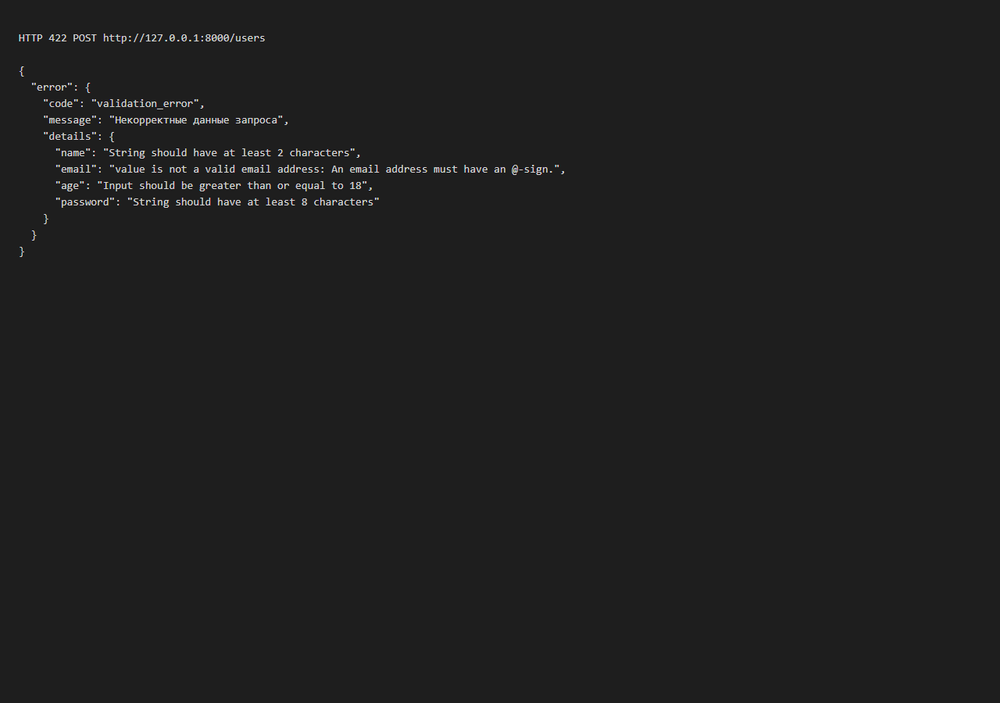
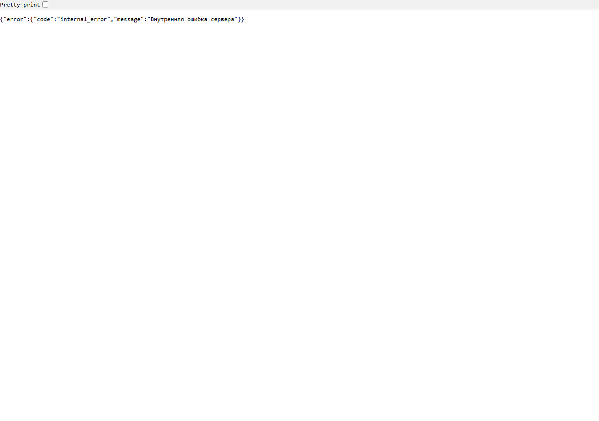

# Лабораторная работа 3: Валидация и обработка ошибок в API

**Дисциплина:** Веб-программирование
**Тема:** Валидация, бизнес-правила и обработка ошибок

---

## Что сделано

- Усилена валидация модели пользователя (`app/users.py`):
  - `name`: 2–50 символов, только буквы, пробелы и дефисы
  - `email`: валидный формат (pydantic `EmailStr`)
  - `age`: 18–120
  - `password`: минимум 8 символов, обязаны быть буквы и цифры; **не попадает в ответы** (`exclude=True`)
- Структурированные ошибки (`app/errors.py`) — единый формат:

```json
{"error": {"code": "...", "message": "...", "details": { ... } }}
```

- Обработчики ошибок: валидация (422), доменные ошибки `AppError`/`ConflictError`/`NotFoundError`, HTTP-ошибки (404/405/...), перехват всех необработанных исключений (500)
- Логирование (`logging`): ошибки валидации — WARNING, необработанные исключения — ERROR со стеком; пароли и токены не логируются

## Проверка работы (curl)

```
POST /users {"name":"J","email":"invalid-email","age":15,"password":"123"}
→ 422 {"error":{"code":"validation_error","message":"Некорректные данные запроса",
     "details":{"name":"String should have at least 2 characters",
                "email":"value is not a valid email address...",
                "age":"Input should be greater than or equal to 18",
                "password":"String should have at least 8 characters"}}}

POST /users {"name":"John Doe","email":"john@example.com","age":30,"password":"pass12345"}
→ 201 {"id":1,"name":"John Doe","email":"john@example.com","age":30}   // пароля в ответе нет

POST /users (тот же email) → 409 {"error":{"code":"conflict","message":"...","details":{"email":"already_taken"}}}
GET /users/99              → 404 {"error":{"code":"not_found","message":"Пользователь не найден"}}
GET /debug/boom            → 500 {"error":{"code":"internal_error","message":"Внутренняя ошибка сервера"}}
```

В логах при 500: `ERROR app: Необработанная ошибка при GET /debug/boom` + полный traceback; при валидации: `WARNING app: Ошибка валидации POST /users: {...}`.

---

## Скриншоты

Структурированная ошибка валидации (HTTP 422, единый формат ошибок):



Обработка необработанного исключения (HTTP 500 — клиенту общее сообщение, подробности в логах):



---

## Задание 1: Валидация данных

Данные: `{"name": "J", "email": "invalid-email", "age": 15, "password": "123"}`

1. **Не пройдут все четыре проверки:** name (1 символ < 2), email (нет `@`), age (15 < 18), password (3 символа < 8).
2. **Статус-код:** 422 Unprocessable Entity (или 400 — оба допустимы; в проекте используется 422, стандартный для FastAPI/pydantic).
3. **Структура ошибки:** код, сообщение и детали по полям (см. пример выше).
4. **Ответ сервера:**

```json
{"error":{"code":"validation_error","message":"Некорректные данные запроса",
  "details":{"name":"String should have at least 2 characters",
             "email":"value is not a valid email address...",
             "age":"Input should be greater than or equal to 18",
             "password":"String should have at least 8 characters"}}}
```

## Задание 2: Различие значений

| Случай | Значение | Что означает |
|--------|----------|--------------|
| Поле отсутствует | *нет ключа в JSON* | Клиент ничего не передал — для обязательного поля ошибка; в PATCH — «не изменять» |
| Поле = null | `null` | Клиент явно передал «пусто» — обычно ошибка для обязательного поля |
| Поле = "" | пустая строка | Передана пустая строка — проходит проверку «поле есть», но падает min_length |
| Поле = 0 | число 0 | Валидное число; для возраста упадёт на `ge=18`, но не как «отсутствующее» |
| Поле = false | логическое false | Валидное логическое значение; ошибка, если ожидается другой тип |

Разница важна: отсутствие и `null` — это не одно и то же; `0` и `""` — легитимные значения, которые нельзя отбрасывать через проверки вида `if not value`.

## Задание 3: Формат vs бизнес-правила

| Проверка | Формат | Бизнес-правило |
|----------|:------:|:--------------:|
| Email содержит @ | ✔ | |
| Email уникален | | ✔ (требует запроса к БД) |
| Возраст >= 18 | | ✔ (правила домена) |
| Возраст — число | ✔ | |
| Пароль минимум 8 символов | ✔ | |
| Пароль не равен логину | | ✔ (сравнение двух полей пользователя) |
| Имя только буквы | ✔ | |
| Имя не содержит цензуру | | ✔ (зависит от контекста/списка) |

Формат проверяется без обращения к данным приложения; бизнес-правила зависят от состояния системы и других полей.

## Задание 4: Бизнес-правила

**Пользователь**
- Регистрация: email уникален; пароль соответствует требованиям; возраст ≥ 18.
- Изменение email: новый email валиден и не занят другим пользователем; подтверждение через письмо.
- Удаление аккаунта: только сам пользователь или админ; удаление/анонимизация связанных данных; нельзя удалить, есть ли активные заказы.

**Заказ**
- Создание: корзина не пуста; все товары в наличии; пользователь активен.
- Изменение статуса: переходы только по разрешённой схеме (`new → paid → shipped → delivered`); отмена возможна только до оплаты; менять статус может только авторизованный сотрудник.
- Отмена: заказ не отправлен; при оплате — запуск возврата средств.

**Комментарий**
- Добавление: пользователь аутентифицирован; текст не пустой и не превышает лимит; пост существует и открыт для комментариев.
- Удаление: автор комментария, автор поста или модератор.

## Задание 5: Структура ошибки

```json
// 1. Ошибка валидации (422)
{"error":{"code":"validation_error","message":"Некорректные данные запроса",
  "details":{"email":"Невалидный адрес","age":"Должно быть от 18 до 120"}}}

// 2. Конфликт (409)
{"error":{"code":"conflict","message":"Пользователь с таким email уже существует",
  "details":{"email":"already_taken"}}}

// 3. Не найдено (404)
{"error":{"code":"not_found","message":"Пользователь не найден"}}

// 4. Внутренняя ошибка (500) — без внутренних деталей
{"error":{"code":"internal_error","message":"Внутренняя ошибка сервера"}}
```

## Задание 6: Сценарии тестирования «Создание пользователя»

**Обычные:** 1) валидные данные → 201, пользователь создан; 2) создание второго пользователя с другим email → 201.
**Граничные:** 1) name ровно 2 и ровно 50 символов; 2) age ровно 18 и ровно 120; 3) password ровно 8 символов.
**Ошибочные:** 1) невалидный email → 422; 2) дублирующийся email → 409; 3) age = 17 или строка вместо числа → 422; 4) отсутствует обязательное поле → 422.

## Задание 7: Псевдокод обработки ошибок

```python
def create_user(request):
    try:
        data = validate(request.body)          # формат
        check_business_rules(data)             # email уникален и т.п.
        user = db.save(data)
        return 201, user
    except ValidationError as e:
        return 422, {"error": {"code": "validation_error", "details": e.fields}}
    except BusinessRuleError as e:
        return 409, {"error": {"code": "conflict", "message": str(e)}}
    except DatabaseError as e:
        log.error("Database error: %s", e)     # в лог — подробности
        return 500, {"error": {"code": "internal_error"}}
    except Exception as e:
        log.exception("Unexpected error")      # полный стек
        return 500, {"error": {"code": "internal_error"}}
```

## Задание 8: Логирование

| Данные | Логировать | Почему |
|--------|:----------:|--------|
| Пароль пользователя | Нет | Секрет; риск утечки |
| Email пользователя | Да (INFO) | Идентификатор для расследования; не секрет, но нужен контроль доступа к логам |
| Стек ошибки | Да (ERROR) | Необходим для диагностики |
| IP-адрес клиента | Да | Безопасность, анализ злоупотреблений |
| User-Agent | Да | Диагностика клиентских проблем |
| Токен авторизации | Нет | Секрет; по нему можно захватить сессию |
| Время выполнения | Да | Производительность, поиск узких мест |
| SQL-запрос | Да (DEBUG) | Полезен при отладке БД; на проде — без параметров/на уровне DEBUG |

## Задание 9: Анализ ошибки

Лог: `ValueError: invalid literal for int() with base 10: 'abc'` при `POST /users` с `"age": "abc"`.

1. **Что случилось:** строка `'abc'` была передана там, где коду нужно число; преобразование `int()` упало.
2. **Где валидировать:** на входе, до бизнес-логики — схема запроса (pydantic) должна гарантировать тип `age: int`.
3. **Статус клиенту:** 422 (ошибка данных запроса).
4. **Что сообщить:** «age должен быть целым числом от 18 до 120» — по-русски, по делу, без внутренних деталей.
5. **Что исправить:** добавить типизированную схему (`age: int` с ограничениями), убрать ручное `int()` из обработчика; ошибка преобразования исчезнет, потому что неправильный запрос будет отклонён валидацией.

## Задание 10: Практическая реализация

Реализовано в `app/users.py` (модель `UserCreate` с `Field`-ограничениями и `field_validator`, частичная валидация в `UserUpdate`) и `app/errors.py` (кастомные классы ошибок, логирование валидаций — WARNING). Все сценарии из задания 6 проверены через curl (см. раздел «Проверка работы»).

---

## Выводы

API стал надёжным: все входные данные валидируются по формату и диапазонам, бизнес-правила (уникальность email) отделены от проверки формата, ошибки возвращаются в едином структурированном формате с понятными сообщениями, ошибки сервера логируются со стеком, а клиент получает только безопасное общее сообщение.
