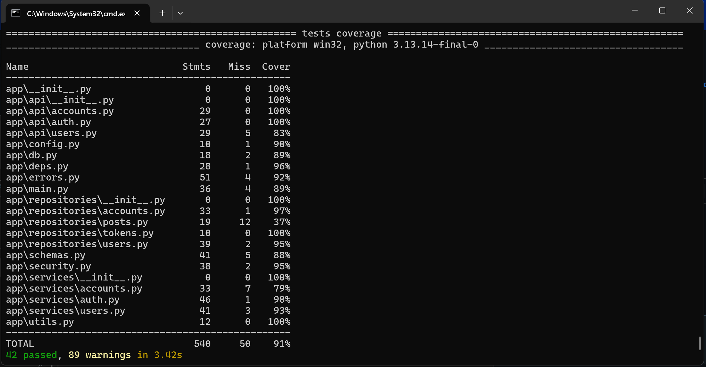

# Лабораторная работа 5: Тестирование API

**Дисциплина:** Веб-программирование
**Тема:** Основы автоматического тестирования

---

## Что сделано

- **Unit-тесты** (`tests/unit/`):
  - `test_validate_email.py` — 6 сценариев валидации email (параметризованный тест)
  - `test_user_service.py` — бизнес-логика сервиса с моками репозитория (проверка вызовов моков, исключения `ConflictError`/`NotFoundError`)
- **Integration-тесты** (`tests/integration/test_users_api.py`) — весь API через `TestClient` с реальной SQLite-базой во временной папке: обычные, граничные и ошибочные сценарии
- Изоляция тестов: каждый тест получает чистую временную БД через `tmp_path` и override зависимости `get_settings` (DI из лабораторной 4)
- Запуск с покрытием: `pytest --cov=app` → **27 тестов пройдено, покрытие 92%**

```bash
.venv\Scripts\python -m pytest tests -q --cov=app
```

```
27 passed in 0.71s
TOTAL: 92% coverage
```

---

## Скриншоты

Прогон тестов в терминале — 42 теста пройдено, покрытие 91%:



---

## Задание 1: Unit-тест валидации email

Реализовано в `app/utils.py` + `tests/unit/test_validate_email.py` (параметризованный тест, формат Arrange-Act-Assert):

| Сценарий | Email | Ожидание |
|----------|-------|----------|
| Валидный | `john@example.com` | True |
| Без @ | `johnexample.com` | False |
| Несколько @ | `jo@hn@example.com` | False |
| Пустая локальная часть | `@example.com` | False |
| Пустая доменная часть | `john@` | False |
| Домен без точки | `john@examplecom` | False |

## Задание 2: Arrange-Act-Assert

```python
def test_create_user(client):
    # Arrange: payload = {"name": "John Doe", ...}
    # Act
    response = client.post("/users", json=payload)
    # Assert
    assert response.status_code == 201
    assert response.json()["email"] == "john@example.com"
```

Все тесты проекта написаны в этом формате (комментарии AAА в unit-тестах).

## Задание 3: Unit-тест с моками

`tests/unit/test_user_service.py`:

```python
def test_create_success():
    # Arrange
    service, repo = make_service()          # repo = Mock()
    repo.get_by_email.return_value = None
    repo.create.return_value = Mock(id=1, ...)
    # Act
    user = service.create(UserCreate(...))
    # Assert: возвращаемое значение и вызовы моков
    assert user.id == 1
    repo.get_by_email.assert_called_once_with("john@example.com")
    repo.create.assert_called_once()
```

Также проверено: при дубликате email `repo.create.assert_not_called()`, при отсутствующем пользователе `pytest.raises(NotFoundError)`.

## Задание 4: Сценарии для create_user (реализованы в integration-тестах)

**Обычные:** создание с валидными данными → 201; список с поиском/пагинацией → 200.
**Граничные:** age = 18 → 201, age = 17 → 422; name длиной 1 → 422, ровно 50 → 201; password длиной 8 → 201, длиной 7 → 422.
**Ошибочные:** дублирующийся email → 409; невалидный email → 422 с деталями по полю; отсутствие обязательного поля → 422; обновление/удаление несуществующего → 404.

## Задание 5: Integration-тест

`tests/conftest.py` поднимает `TestClient` с override `get_settings` → временный файл БД (`tmp_path`), настоящий `UserRepository` и реальный SQLite. Данные автоматически изолированы (новая БД на каждый тест), файл удаляется вместе с временной папкой. Пример — `test_create_user`: POST → 201, затем GET подтверждает сохранение в БД.

## Задание 6: Регрессионный тест

Паттерн: сначала пишется тест, воспроизводящий баг (красный), затем исправление (зелёный), тест остаётся в наборе навсегда. Пример для скидки:

```python
def test_discount_is_not_negative():
    assert calculate_discount(100, "NOVICE") >= 0   # упал: -10
# исправление: total = max(0, price * (1 - rate))
```

После исправления тест защищает от повторного появления бага (регрессии) — это и есть регрессионное тестирование.

## Задание 7: Уровни тестирования

| Уровень | Что проверяет | В проекте |
|---------|---------------|-----------|
| Unit | Бизнес-логика изолированно (сервис + моки) | `tests/unit/test_user_service.py` |
| Integration | Слои вместе с реальной БД, HTTP-коды и форматы | `tests/integration/test_users_api.py` |
| E2E | Весь продукт как чёрный ящик (будет в лабе 9: запуск приложения + БД в Docker) | — |

## Задание 8: Test doubles (двойники)

| Вид | Что это | Где применён |
|-----|---------|--------------|
| Dummy | Пустышка, лишь бы параметр существовал | — |
| Fake | Рабочая упрощённая реализация (in-memory БД) | Временный SQLite-файл в интеграционных тестах |
| Stub | Заготовка с фиксированным ответом | `repo.get.return_value = Mock(id=1)` |
| Mock | Стуб + проверка вызовов | `repo.create.assert_called_once()` |
| Spy | Обёртка, записывающая вызовы реального объекта | Логи middleware (косвенно) |

## Задание 9: Структура тестового проекта

```
tests/
├── conftest.py                 # фикстуры: TestClient + временная БД
├── unit/
│   ├── test_validate_email.py
│   └── test_user_service.py
└── integration/
    └── test_users_api.py
```

Плюс инфраструктура: `pytest`, `pytest-cov`, `httpx` (TestClient). Команда запуска: `python -m pytest tests -q --cov=app`.

---

## Выводы

Основной функционал API покрыт тестами на двух уровнях: unit (бизнес-логика, моки) и integration (HTTP поверх реальной БД). Покрытие кода — 92%. Тесты построены по паттерну Arrange-Act-Assert, сценарии включают обычные, граничные и ошибочные случаи.
