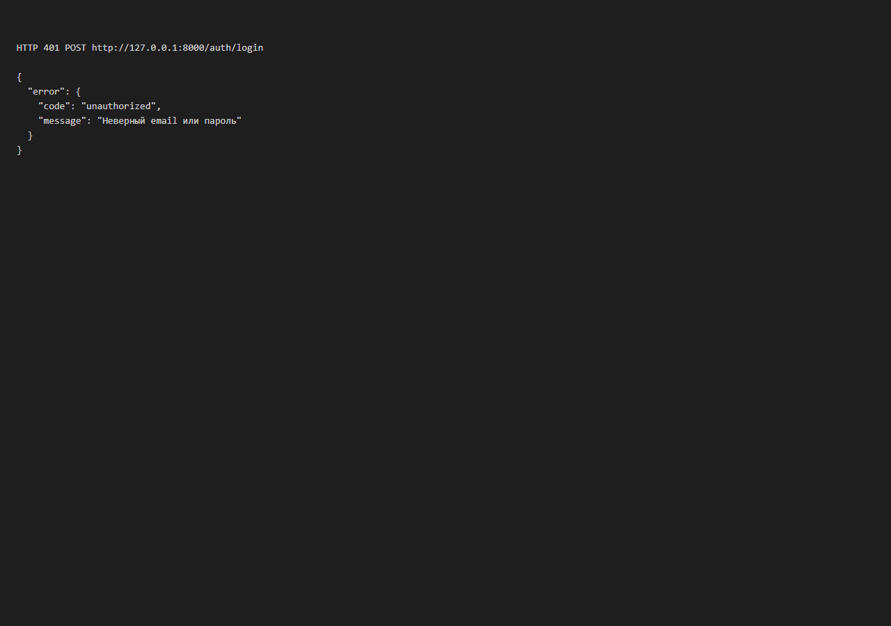

# Лабораторная работа 6: Аутентификация и работа с базой данных

**Дисциплина:** Веб-программирование
**Тема:** Состояние пользователя (токены) + Работа с БД

---

## Что сделано

Реализована JWT-аутентификация поверх приложения из лабораторных 4–5:

- **Хеширование паролей** (`app/security.py`): PBKDF2-HMAC-SHA256, 100 000 итераций, случайная соль, сравнение через `hmac.compare_digest` (защита от timing-атак). В БД хранится `pbkdf2$<salt>$<hash>`
- **JWT-токены** (PyJWT): access — 15 минут, refresh — 7 дней; в payload — `sub` (id), `email`, `kind` (тип токена), `exp`, `jti` (id для blacklist)
- **Blacklist отозванных токенов** — таблица `revoked_tokens` в БД (в лабе 10 переносится в Redis)
- **Миграция схемы БД** (`app/db.py`): автоматическое добавление колонки `password_hash` к существующей таблице `users` (старые данные не теряются)
- **Endpoints** (`app/api/auth.py`): `POST /auth/register`, `POST /auth/login`, `POST /auth/refresh`, `POST /auth/logout`, `GET /auth/me`
- **Защита endpoint'ов**: зависимость `get_current_user` проверяет Bearer-токен, подпись, срок, тип и blacklist → 401 при любой проблеме
- Секретный ключ — только из переменной окружения `SECRET_KEY` (см. `.env.example`)
- Добавлены integration-тесты аутентификации: **36 тестов, покрытие 94%**

## Проверка работы (curl)

```
POST /auth/register {name, email, age, password}     → 201 (пароль в ответ не попадает)
POST /auth/login    {email, password}                → 200 {access_token, refresh_token, token_type}
GET  /auth/me     + Authorization: Bearer <access>   → 200 профиль
GET  /auth/me     без токена                         → 401 "Отсутствует токен авторизации"
POST /auth/login  неверный пароль                    → 401 "Неверный email или пароль"
POST /auth/refresh {refresh_token}                   → 200 новая пара токенов
POST /auth/logout  {refresh_token}                   → 204
POST /auth/refresh старым refresh после logout       → 401 "Токен отозван"
GET  /auth/me     с refresh-токеном вместо access    → 401 "Неверный тип токена"

SELECT email, password_hash FROM users:
→ [('john@example.com', 'pbkdf2$Qtr6toniUmlG+Jlz3D...')]  — пароль в открытом виде не хранится
```

## Скриншоты

Успешный вход: сервер выдаёт пару JWT (access + refresh):



---

## Сравнение Session vs JWT (задание 4 занятия 7)

| Критерий | Session (cookies) | JWT |
|----------|-------------------|-----|
| Где хранится состояние | На сервере (session store) | У клиента (в токене) |
| Масштабирование | Нужна общая session-store для нескольких серверов | Stateless — любой сервер проверит по подписи |
| Отзыв | Мгновенный (удалить сессию) | Трудный: токен валиден до exp — нужен blacklist |
| Хранилище | Память/Redis/БД на сервере | Ничего (плюс blacklist при необходимости) |
| CSRF | Уязвимы (нужен CSRF-токен) | Устойчивы (обычно в заголовке, не в cookie) |
| XSS | HttpOnly-cookie защищает от чтения | Токен доступен JS → нужен XSS-контроль |

В работе выбран JWT с refresh-токенами и blacklist — компромисс между масштабируемостью и возможностью отзыва.

## Выводы

Система аутентификации работает полностью: регистрация с хешированием паролей, вход с выдачей пары JWT, защищённый профиль, обновление и отзыв токенов. Схема БД эволюционирует через миграции, все запросы параметризованы, состояние пользователя реализовано без серверных сессий.
